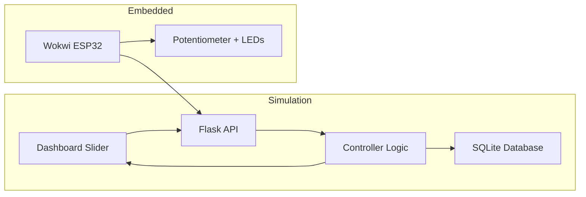

# Architecture Overview



## System design summary

- The dashboard provides the user-facing control surface.
- The Flask API validates requests and passes them to the controller.
- The controller handles hysteresis and mode transitions.
- SQLite persists readings and events.
- Wokwi firmware simulates sensor and output states for educational demonstration.

## Irrigation decision flow

```mermaid
flowchart TD
    start([Start]) --> read[Read moisture]
    read --> check{Mode = AUTOMATIC?}
    check -- No --> manual[Manual control check]
    check -- Yes --> dry{Moisture < Dry Threshold?}
    dry -- Yes --> on[Pump ON]
    dry -- No --> wet{Moisture >= Wet Threshold?}
    wet -- Yes --> off[Pump OFF]
    wet -- No --> hold[Retain previous state]
    manual --> decision[Apply manual command]
    on --> save[Record reading and event]
    off --> save
    hold --> save
    decision --> save
    save --> end([End])
```
