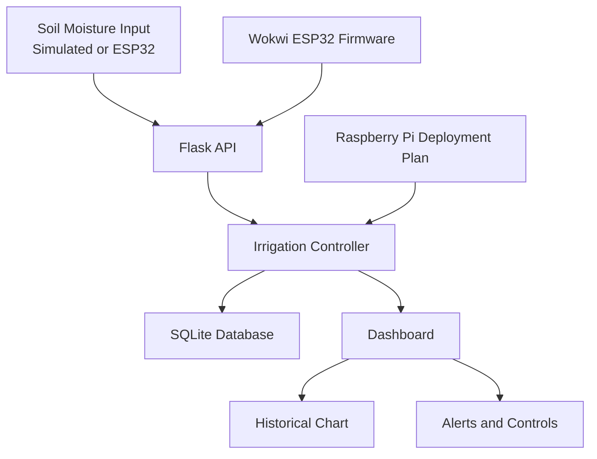

# Design and Development of an Intelligent Sensor-Based Automated Irrigation System for Smart Agriculture Using Raspberry Pi and IoT Technology

## 1. Title Page

Institution: SRM Institute of Science and Technology, Tiruchirappalli

Course: 21NT0308T — Smart Sensor System

Project Type: Smart Sensor System / Embedded Systems / IoT / Automation

Student Team: Academic prototype developed as a two-student project

Document status: Draft academic prototype documentation

## 2. Abstract

This project presents a prototype intelligent irrigation system designed for academic demonstration and software validation. The system monitors soil moisture, applies hysteresis-based control logic, stores readings in SQLite, and provides a web dashboard for live monitoring and historical insight. A software simulation mode allows the project to run without physical hardware. A Wokwi ESP32 firmware simulation and a Raspberry Pi deployment plan are also included to reflect the intended real-world implementation. The solution is designed for learning and demonstration, not as a physically verified precision agricultural deployment.

## 3. Keywords

Smart agriculture, Internet of Things, irrigation automation, soil moisture, Raspberry Pi, ESP32, Flask, SQLite, Wokwi, dashboard, hysteresis.

## 4. Introduction

Agriculture requires timely and efficient water management. Traditional irrigation approaches often lead to overwatering or underwatering because they lack real-time soil analysis and adaptive control. This project attempts to develop a practical demonstration of a smart irrigation system using soil moisture sensors and threshold-based control logic.

The implemented prototype emphasizes software simulation and dashboard-based monitoring. It provides a clear path to future hardware integration with Raspberry Pi and sensor interfaces while staying runnable on an ordinary local machine.

## 5. Background and Motivation

Many small and medium-sized farms need low-cost automation for irrigation scheduling. Soil moisture is a key parameter in deciding when water should be delivered. Because soil moisture fluctuates with weather, soil texture, and plant type, a simple single-threshold trigger is often insufficient. Hysteresis helps maintain stability by preventing rapid pump switching around threshold boundaries.

The project focuses on educational value and demonstrative clarity. It includes an irrigation controller, a web dashboard, persistent storage, telemetry handling, and optional hardware simulation paths.

## 6. Problem Statement

An irrigation system should monitor soil condition and decide whether watering is advisable. It must prevent unsuitable operating conditions, support manual override when needed, and help users understand sensor changes over time. The project addresses this through a software prototype that demonstrates these behaviors without requiring expensive hardware during development.

## 7. Project Objectives

- Develop a smart irrigation control system using moisture thresholds and hysteresis.
- Build a dashboard for monitoring and simulation.
- Store readings and events in SQLite.
- Support automatic and manual operating modes.
- Provide a simulation pathway with a Wokwi ESP32 implementation.
- Document the intended real-world Raspberry Pi deployment.

## 8. Scope and Limitations

The project covers software simulation, web monitoring, threshold control, data persistence, and documentation. It does not claim field-tested agricultural optimization or physical pump safety certification.

## 9. Proposed System

The system comprises:

- software simulator input for moisture values
- irrigation controller with hysteresis logic
- Flask API and dashboard
- SQLite database for readings and events
- optional ESP32 telemetry integration
- Raspberry Pi hardware plan for future deployment

## 10. Overall System Architecture



## 11. Hardware Architecture

The implemented project uses simulation hardware rather than physical devices. The intended hardware path uses a Raspberry Pi, capacitive soil moisture sensor, ADC, relay or transistor driver, and pump power supply. The Wokwi design uses an ESP32 DevKit v1, potentiometer, and LEDs to emulate sensor and pump status.

## 12. Software Architecture

The software is separated into modules:

- controller: moisture decision logic and hysteresis
- database: SQLite lifecycle and data access
- routes: Flask API endpoints
- services: orchestration of state changes and telemetry processing
- validation: input checking for moisture, thresholds, and telemetry
- sensor: sensor abstraction for simulation and future hardware integration

## 13. Technology Stack

- Frontend Framework: React 19 SPA
- Bundler & Dev Server: Vite 8
- Data Visualization: Recharts
- Icon System: Lucide React
- Routing: React Router DOM 7
- Backend API Service: Python 3.13 / Flask
- Database Engine: SQLite 3
- Testing Framework: Pytest
- Firmware Simulation: Wokwi ESP32 C++ firmware
- Physical Reference Design: Raspberry Pi 4 Model B Deployment Architecture

## 14. Component Selection and Justification

The project uses a lightweight, low-cost software stack to ensure the prototype can be demonstrated in a classroom environment. Flask is chosen for simplicity and API clarity. SQLite provides persistent, local storage without extra infrastructure. The Wokwi ESP32 simulation mirrors an embedded prototype while avoiding hardware purchases. The Raspberry Pi plan reflects realistic deployment choices without claiming actual device validation.

## 15. Sensor Acquisition and Data Processing

The system accepts moisture readings from either a simulated dashboard slider or ESP32 telemetry. The values are validated and classified into one of three soil states: DRY, TRANSITION, or ADEQUATE.

## 16. Moisture Calibration Method

The software uses a simulation convention for the virtual input:

```text
moisture_percentage = (raw_adc / 4095.0) * 100.0
```

This is a demonstration mapping only and is not presented as a calibrated field measurement technique.

## 17. Irrigation Decision Algorithm

The controller applies the following logic:

```text
if moisture < 35:
    pump ON
else if moisture >= 45:
    pump OFF
else:
    maintain previous state
```

This demonstrates hysteresis behavior and prevents rapid state toggling around the threshold region.

## 18. Hysteresis and Threshold Selection

The thresholds are configured as:

- Dry threshold: 35.0
- Wet threshold: 45.0

These are demonstration values for the prototype and are not universal agricultural recommendations.

## 19. IoT Communication Architecture

The prototype supports HTTP REST endpoints for status, sensor simulation, and telemetry ingestion. The Wokwi firmware can optionally send telemetry to the Flask server when network connectivity is available. The system explicitly documents that the simulator cannot assume localhost access and requires a reachable network path or gateway.

## 20. Database Design

The project uses SQLite with tables for:

- sensor_readings
- irrigation_events
- settings

The database is initialized automatically at startup and supports reset for demonstration use.

## 21. Dashboard Design & User Experience

The user interface is implemented as a modern agricultural SaaS platform named **TerraSense IQ** using a refined light theme design system (forest green `#176B4D`, secondary green `#2E8B62`, subtle green `#EAF5EF`). The platform organizes monitoring and simulation into seven dedicated pages:
1. **Overview**: Executive monitoring dashboard with real-time soil condition, pump status, dynamic decision explanation, fixed Recharts historical trend graph with dry/adequate threshold reference lines, and quick scenario injection.
2. **Live Monitoring**: Real-time telemetry feed with configurable polling rate (1s-10s), telemetry freshness tracking, and virtual 12-bit ADC mapping.
3. **Virtual Field Lab**: Complete 7-stage interactive dataflow pipeline visualization and digital-twin plant and drip irrigation SVG animation.
4. **History & Analytics**: Multi-parameter filtering by date range, condition, and source, coupled with RFC 4180 CSV export and protected Clear History management.
5. **Irrigation Events**: Audit trail tracking discrete controller state transitions.
6. **Configuration**: Validated dual-threshold hysteresis controls ($T_{wet} > T_{dry}$), interactive deadband zone preview, operating mode switch, and theme preferences.
7. **System Information**: Comprehensive platform architecture specifications, mathematical hysteresis formulation, and runtime health diagnostics.

## 22. Wokwi Simulation Setup

The Wokwi folder contains the circuit description and Arduino firmware for the embedded simulation. The project uses the ESP32 DevKit v1 with a potentiometer as the moisture source and LEDs to represent soil and irrigation states. The circuit follows the specified GPIO mapping and resistor values.

## 23. Implementation Details

The project was implemented as a modular Flask application with a controller, validation layer, database utilities, and route handlers. The system starts in automatic mode with default thresholds and supports simulated manual override.

## 24. Test Methodology

The automated tests validate controller logic, API behavior, and SQLite creation. The test suite uses Python's pytest framework and exercises the main decision cases described in the project requirements.

## 25. Test Cases and Expected Results

- moisture below dry threshold => pump ON
- moisture above wet threshold => pump OFF
- moisture inside hysteresis band when pump is OFF => stay OFF
- moisture inside hysteresis band when pump is ON => stay ON
- invalid moisture => rejected
- invalid threshold combinations => rejected
- manual control in manual mode => accepted
- manual control in automatic mode => rejected
- API reads return valid JSON
- telemetry validation works
- database creation and persistence work

## 26. Actual Results and Observations

The automated test suite executed successfully with 24 passing tests. The current implementation has been verified for dual-threshold hysteresis logic, boundary condition handling, manual operator overrides, API request validation, targeted clear history actions, and SPA client route resolution. No physical hardware validation was performed because the project was executed in software simulation and a local prototype environment.

## 27. Discussion

The prototype demonstrates the core principles of smart irrigation and embedded monitoring. It is well suited for academic evaluation because it is lightweight, understandable, and easy to extend. It also demonstrates the difference between simulation-required demonstration work and a true physical deployment. The project intentionally avoids claiming field-ready performance or hardware calibration.

## 28. Security and Safety Considerations

- No hardcoded secrets or cloud credentials are used.
- The project is designed for local academic use.
- The pump output is simulated and not presented as approved industrial control hardware.
- Physical Raspberry Pi installation guidance includes required relay or driver usage and safety precautions.

## 29. Limitations

- No real sensor calibration was performed.
- No Raspberry Pi hardware was physically tested.
- No field deployment or water-saving claim is made.
- Telemetry integration is optional and depends on network availability.

## 30. Conclusion

This project successfully delivers a working, demonstrable irrigation control prototype that can be evaluated in a local academic environment. It combines automated logic, SQLite persistence, API endpoints, a dashboard, and a Wokwi simulation path. The implementation is suitable for a viva and technical report while remaining clear about the distinction between simulated and physical hardware elements.

## 31. Future Enhancements

- Add MQTT telemetry support.
- Include a Raspberry Pi sensor interface implementation.
- Add user authentication for local network exposure.
- Improve chart filtering and historical analytics.
- Add alert consolidation and email or SMS notifications for local deployment.

## 32. References

1. Wokwi documentation: https://docs.wokwi.com/
2. Raspberry Pi documentation: https://www.raspberrypi.com/documentation/
3. ESP32 technical documentation: https://docs.espressif.com/projects/esp-idf/en/latest/esp32/
4. Capacitive soil moisture sensor references from vendor documentation and application notes.

The references above are kept at a general documentation level and are appropriate for academic context. No fabricated references or non-verifiable citations are included.

## 33. Appendix: Code and Configuration

Included in the project repository:

- Flask application and routes
- irrigation controller logic
- SQLite database access layer
- Wokwi firmware and diagram files
- HTML, CSS, and JavaScript dashboard assets
- pytest-based automated verification

This appendix highlights that the implementation is available in the project source files rather than being described as a conceptual prototype only.

## Test Results Template (Executed & Verified)

Status: Executed locally for the current software simulation platform.

- Controller & Hysteresis Decision Tests: Passed (15 tests)
- API Endpoint & Routing Tests: Passed (7 tests)
- Database Persistence & Audit Log Tests: Passed (2 tests)
- Total Automated Test Suite: 24 tests passed (0 failures)
- Hardware/Wokwi verification: Documented simulation reference design
- Raspberry Pi physical validation: Documented future target architecture

This project does not claim physical experimental performance metrics beyond the verified local software tests listed above.
